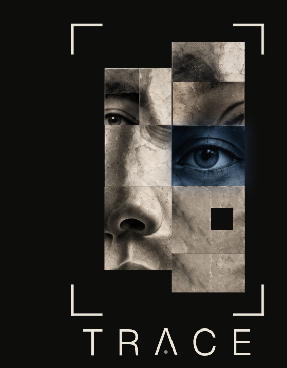
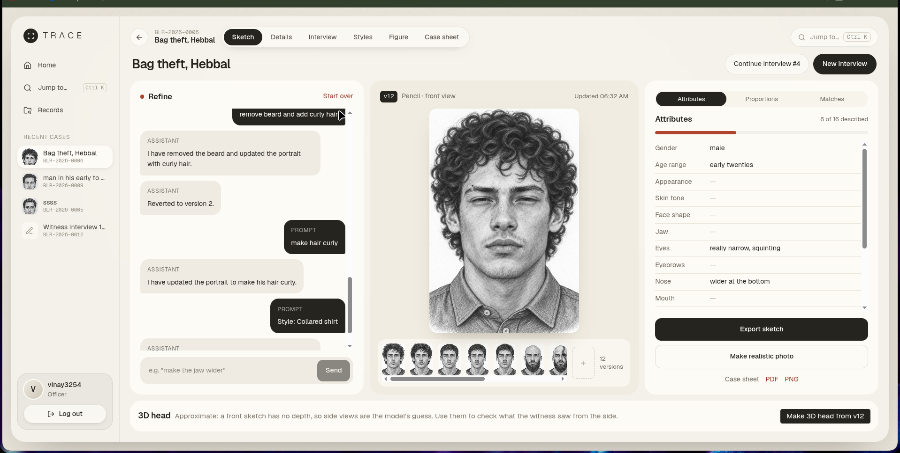
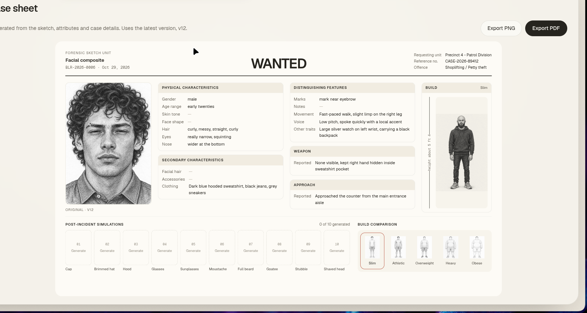

<p align="center">
  
</p>

<h1 align="center">TRACE</h1>
<p align="center"><b>Forensic sketch workspace</b>: from a witness's words to a pencil composite, a 3D figure and leads from the records.</p>
<p align="center">HackFest 2026 · Track 1 (AI Nexus) · Problem T1-P</p>

---

An officer interviews a witness (typed, or spoken in one of eight Indian languages), gets a black-and-white
forensic pencil sketch, refines it by chat and with sliders, turns it into a realistic photo, a full-body figure
and a 3D model, checks it against a criminal-records database, and prints a one-page case sheet. Every action is
written to a tamper-evident audit log, and admins watch their investigators' work live on a dashboard.

> **Disclaimer.** TRACE is an investigative aid. Its sketches, 3D figures, translations and record matches are
> produced with AI from witness accounts and are not proof of anyone's identity. All output should be reviewed by a
> trained officer and corroborated by independent evidence.

## Screenshots

| | |
|---|---|
|  **Home**: describe a face, interview a witness, or reopen a case. |  **Sketch**: refine by chat, version history, attributes, proportion sliders and suspect matches. |
|  **Case sheet**: one-page composite with characteristics, incident details, build and disguise simulations. |  **3D model**: the full-body drawing (left) turned into a 3D figure, seen from the front, side and back. |

## What it does

1. **Sign in or sign up.** Investigators create their own accounts; an admin account needs an admin code. Admins land on a live dashboard, investigators on their cases.
2. **Open a case.** Each case gets a number (BLR-2026-0013) and tabs: Sketch · Details · Interview · Styles · Figure · Case sheet.
3. **Interview the witness.** Fixed, neutral questions are read aloud; answers are typed or spoken (English, Hindi, Kannada, Telugu, Tamil, Malayalam, Marathi, Bengali, Gujarati), kept word for word with an English translation, and locked with a SHA-256 fingerprint once the witness confirms them.
4. **Draw the sketch.** The description becomes a list of facial features and the image model draws a pencil composite.
5. **Refine it.** "Make the moustache thicker" changes only that part of the face; proportion sliders (eye size and spacing, nose, mouth, face length, jaw) reshape it instantly, without AI.
6. **Photo, disguises and styles.** Turn the sketch into a realistic colour photo, draw it with a cap, glasses or a beard, or dress it from a library of clothes and hairstyles.
7. **Details and full body.** Height, build, clothing, voice and walk are recorded, and a full-body drawing that matches the face is made.
8. **3D model.** Side and back views are drawn, a free Kaggle GPU turns the three drawings into a 3D shape (Hunyuan3D-2), and Blender paints it with the drawings. Rotate it in the browser or open it in Blender.
9. **Suspect matching.** The sketch, or better its realistic photo, is compared with every mugshot in the records; the five closest are listed as leads, never as identifications.
10. **Criminal records.** A searchable demo database of 120 fictional people (synthetic faces) with charge histories: FIR, police station, BNS section, status.
11. **Case sheet and export.** One-page A4 sheet (PDF/PNG) and high-resolution exports with a case/version/time/officer footer.
12. **Audit log.** Every action by anyone is chained with SHA-256; *Verify integrity* proves nothing was changed or deleted.
13. **Admin dashboard and oversight.** Who is active right now and on which page, work in progress, sessions from login to logout, and the cases each investigator handled. Each admin oversees the investigators assigned to them.

## Architecture

```
Browser · React 19 + TypeScript + Vite + Tailwind 4 + TanStack Query + three.js
   │  session cookie · page header + 30 s heartbeat (presence) · live updates over Server-Sent Events
   ▼
Backend · Python 3.12 · FastAPI · SQLModel · SQLite
   ├─ auth (JWT cookie, bcrypt, rate limit) → every case route checks case access
   ├─ cases · face (sketch, refine, proportions) · interview · translate · records · matching
   ├─ figure (3D jobs) · body · styles · variants · sheet · export
   ├─ audit (SHA-256 hash chain) · oversight + dashboard · live (presence, work in progress)
   ├─ AI client ──► any OpenAI-compatible gateway (OmniRoute in the demo) ──► chat + image models
   ├─ CPU models (ONNX / MediaPipe): face parser, face matcher, pose detector
   └─ background jobs ──► Kaggle API (private dataset + private GPU notebook)
                        └► Blender (bpy) subprocess: paint the 3D model, build bodies, write .blend files
Blender worker · FastAPI + bpy (port 8020): mannequin editor with live GLB rebuilds
Storage · storage/ (images, models, GLB/.blend, demo mugshots) · app.db (data + audit chain)
```

## Models

| Purpose | Model | Runs on |
|---|---|---|
| Understanding descriptions and edit requests, translation, interview assist | `auto/best-fast` (any chat model behind the gateway) | Cloud API |
| Drawing sketches, full body, side and back views | `codex/gpt-5.6-luna-image` | Cloud API |
| Editing sketches (refine, styles, disguises, realistic photo) | `codex/gpt-5.6-luna` (Responses API image tool) | Cloud API |
| Face regions for localized edits and proportion landmarks | BiSeNet face parser (ONNX) | CPU |
| Face fingerprints for suspect matching | ArcFace `w600k_r50` (InsightFace, ONNX) | CPU |
| Face and eye/nose/mouth points | MediaPipe BlazeFace | CPU |
| Body landmarks and outline | MediaPipe Pose Landmarker (heavy) | CPU |
| Drawings → 3D shape | Hunyuan3D-2 multi-view (Tencent) | Kaggle T4 GPU (free) |
| Parametric human body (mannequin editor) | MPFB2 / MakeHuman in Blender | CPU |
| Speech to text | Web Speech API (Chrome/Edge) | Browser |
| Demo mugshots | FLUXSynID synthetic faces (dataset) | Local files |

## Algorithms

- **Tamper-evident audit log:** each row's SHA-256 covers the previous row's hash and all of its own fields; one changed or deleted row breaks the chain.
- **Locked interviews:** a SHA-256 of the confirmed transcript; "don't know" answers force those features to stay blank; AI-assist quotes are kept only if they appear word for word in the witness's account.
- **Localized edits:** a face-parsing mask of the edited region; the previous sketch is pasted back outside it with a feathered edge.
- **Proportion sliders:** smooth local scale and shift warps around facial landmarks, combined into one backward-mapped displacement field (bilinear resampling).
- **Suspect matching:** face detection → similarity transform (Umeyama) to the 112×112 ArcFace template → 512-number embedding → cosine similarity; strong ≥ 0.50, possible ≥ 0.35. On the demo records, each person's second photo found their own mugshot first 120/120.
- **3D model:** Hunyuan3D-2 builds the shape from front, side and back drawings; Blender scales it to the stated height and projection-paints each face from the drawing its normal faces.
- **Sessions and presence:** login/logout rows grouped into sessions; "active" = a request or heartbeat in the last 2 minutes; a change counter pushed over SSE keeps the dashboard live.
- **Security basics:** bcrypt passwords, signed HS256 JWT cookies with a revocation list, login rate limiting, constant-time admin-code check, case access checked on every route.

## Setup

### Backend

Requires [uv](https://docs.astral.sh/uv/) (it installs Python 3.12).

```bash
cp .env.example .env          # set JWT_SECRET (32+ chars); AI_MOCK=1 runs offline with placeholder images
uv sync
uv run python -m backend.seed # demo users + demo case
uv run uvicorn backend.app:create_app --factory --reload --port 8000
```

Check: `curl localhost:8000/health`. API docs: http://localhost:8000/docs

### Frontend

Requires Node 20+. Start the backend first, then:

```bash
cd frontend
npm install
npm run dev                   # http://localhost:5173, proxies /api to :8000
```

`npm run build` type-checks and builds to `frontend/dist`.

### Connecting the AI models

Any OpenAI-compatible endpoint with chat completions and image generation/editing:

```env
AI_MOCK=0
LLM_BASE_URL=http://localhost:<port>/v1
LLM_API_KEY=<key>
LLM_CHAT_MODEL=auto/best-fast
LLM_IMAGE_MODEL=codex/gpt-5.6-luna-image
LLM_IMAGE_EDIT_API=responses              # image models that cannot take an input image
LLM_IMAGE_EDIT_MODEL=codex/gpt-5.6-luna
```

`uv run python -m scripts.smoke_live` calls each AI operation once and prints timings.

### Optional features (one-time downloads into `storage/`)

| Feature | Command |
|---|---|
| Localized edits and proportion sliders | `uv run --with torch --with torchvision --with onnx python -m scripts.fetch_face_parser` |
| Suspect matching | `uv run python -m scripts.fetch_face_matcher` |
| Demo criminal records (~1 h, Zenodo rate limit) | `uv run --with remotezip python -m scripts.fetch_record_faces 120` then `uv run python -m scripts.seed_records` |
| 3D model: pose model + MPFB2 | `uv run python -m scripts.fetch_realistic_body` and `cd blender_worker && uv sync` |
| 3D model: Kaggle GPU | a Kaggle API token in `~/.kaggle/access_token` (Kaggle → Settings → API) |
| Mannequin editor (Blender worker) | `cd blender_worker && uv run uvicorn server:app --port 8020`, then `FIGURE_URL=http://127.0.0.1:8020` |
| Admin sign-up | set `ADMIN_SIGNUP_CODE` in `.env` (empty turns admin sign-up off) |

Restart the backend after adding any of these. Without them the app still runs; the feature reports what is missing.

### Tests

```bash
uv run pytest                 # ~490 tests; always the mock AI, no network
```

## Demo accounts

Created by `uv run python -m backend.seed`. More accounts can be made on the login page (*Create account*).

| Username | Password | Role |
|---|---|---|
| officer1 | officer1pass | investigator (owns the demo case) |
| officer2 | officer2pass | investigator |
| admin | adminpass | admin |

## Demo script (5 minutes)

1. Sign in as `officer1`. On Home, describe a face ("a man in his thirties, round face, thin moustache") and press enter.
2. Refine twice ("jaw wider", "thicker moustache"); drag the proportion sliders; revert to version 1 to show history.
3. Run a witness interview in Kannada or Hindi with the microphone; show the English translation and the locked transcript.
4. *Make realistic photo*, then *Matches → Find possible matches* to show leads from the records.
5. Open *Figure → Build 3D model* (about 10 minutes on Kaggle) and the *Case sheet*.
6. Sign in as `admin`: the live dashboard shows officer1's sessions and work; open the audit log and click *Verify integrity*.
7. Sign in as `officer2` and try to open officer1's case: access is denied and recorded.

## Licences and data

- Demo mugshots: FLUXSynID (synthetic people, CC BY-NC 4.0); records and charges are generated and fictional.
- ArcFace (InsightFace) and BiSeNet (CelebAMask-HQ) weights: non-commercial research use only.
- MPFB2: GPL-3.0 code, CC0 assets. Hunyuan3D-2: Tencent Hunyuan Community Licence.
- None of these are committed to the repository; the scripts above download them.
