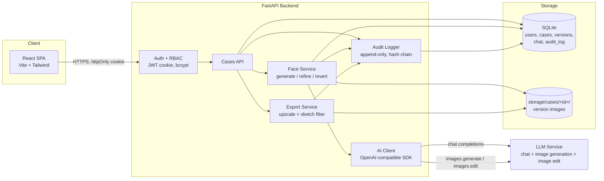
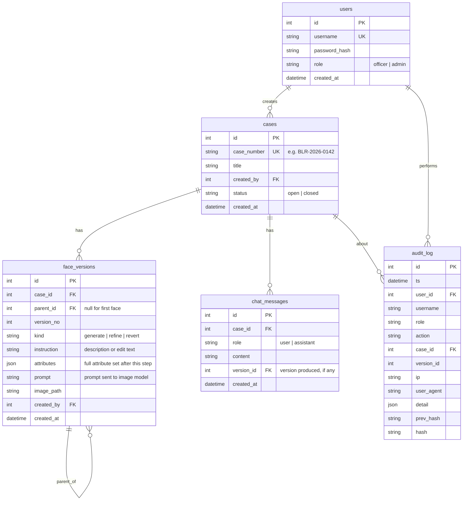
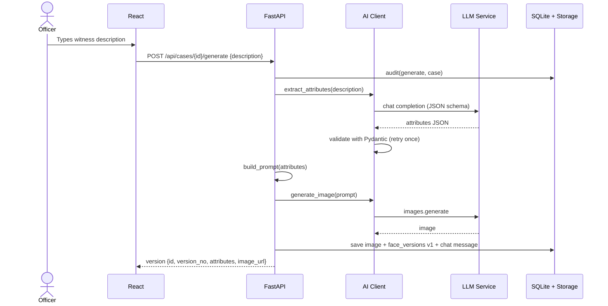
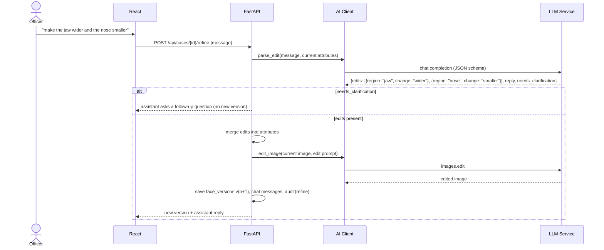

# AI Crime Scene Sketch Generator — System Design

**Event:** HackFest 2026 Season 1, Track 1 (AI Nexus), Problem T1-P
**Date:** 2026-10-28
**Team:** 3 people, 24-hour build
**Status:** Draft for team review

---

## 1. Problem and Goal

Police departments lack forensic sketch artists. A witness can describe a suspect in detail, but turning that description into a usable sketch takes an artist who is often unavailable. Delays let suspects escape and let witness memory fade.

**Goal:** an investigator sits with a witness, types (or later speaks) the description, gets a realistic face in seconds, and refines it through a chat ("make the jaw wider", "eyes closer together") until the witness confirms. The final face exports as a high-resolution image and a pencil sketch. Every access to a case is recorded in an audit log.

### 1.1 Requirements Mapping

| Requirement (from problem statement) | How this design meets it |
|---|---|
| Accept natural-language description of facial features | Description form → LLM extracts structured facial attributes |
| Generate a realistic face image | LLM image generation from a prompt built from the attributes |
| Support iterative refinement | Refinement chat → LLM parses the edit → LLM image edit on the current version |
| Adjust features such as jawline, eyes, nose | Edits are parsed into a fixed region list (jaw, eyes, nose, ...) and applied one region at a time |
| Export a high-resolution sketch | Export endpoint returns upscaled photo PNG and pencil-sketch PNG with case watermark |
| Access audit log: who accessed each case file and when | Append-only, hash-chained `audit_log` table written on every case route; admin audit viewer |
| Tech stack: Generative AI, React, secure backend | LLM service, React (Vite + Tailwind), FastAPI with JWT auth and role-based access |

### 1.2 Success Criteria

- Description to first face in under 40 seconds.
- A refinement changes the requested feature and keeps the rest of the face recognisably the same.
- Every case open, view, generate, refine, revert and export appears in the audit log with user, role, time and IP.
- An officer cannot see another officer's cases. Only an admin can see the audit log.
- The full demo runs without a GPU and survives a failed AI call without crashing.

---

## 2. Architecture



### 2.1 Components

| Component | Responsibility | Depends on |
|---|---|---|
| **React SPA** | Login, case list, workspace (description form, refinement chat, image canvas, version strip), export, admin audit viewer | Backend REST API |
| **Auth + RBAC** | Login, logout, JWT issue and verify, `require_role()` and `require_case_access()` dependencies | `users` table |
| **Cases API** | Create, list, open cases; enforce ownership | Auth, DB, Audit |
| **Face Service** | Generate first face, apply refinements, revert to a version; owns the attribute model and prompt builder | AI Client, DB, file storage |
| **AI Client** | Single wrapper around the LLM service: `extract_attributes()`, `parse_edit()`, `generate_image()`, `edit_image()`. Validates every JSON response with Pydantic. Has a mock mode. | LLM service |
| **Export Service** | Upscale the chosen version, produce a pencil-sketch variant, stamp case number, version and timestamp | Pillow, OpenCV |
| **Audit Logger** | FastAPI dependency plus helper that writes one row per access; computes the hash chain | DB |
| **LLM Service** | External OpenAI-compatible endpoint. Provides chat completions (attribute extraction, edit parsing) and image generation and editing. Swappable by changing `LLM_BASE_URL` and model names. | — |

The backend never talks to a specific AI vendor. It only knows one base URL, one API key and three model names from `.env`. A department could point it at an on-premise model without code changes.

---

## 3. Data Model (SQLite via SQLModel)



### 3.1 Rules

- A case's current version is its `face_versions` row with the highest `version_no` (no separate column). A revert creates a **new** version that copies an older image and attributes; history is never rewritten.
- `audit_log` is append-only. The app has no update or delete path for it.
- `audit_log.hash = sha256(prev_hash + ts + user_id + action + case_id + version_id + detail)`. `GET /api/audit/verify` recomputes the chain and reports the first broken row, if any. This makes tampering visible.
- Audit actions: `login`, `login_failed`, `logout`, `case_create`, `case_list`, `case_open`, `image_view`, `generate`, `refine`, `revert`, `export`, `audit_view`, `access_denied`.

---

## 4. Facial Attribute Model

The LLM converts free text into this fixed structure. The prompt builder only reads this structure, so prompts stay consistent and every change is explainable.

```json
{
  "gender": "male",
  "age_range": "30-35",
  "skin_tone": "medium brown",
  "face_shape": "square",
  "jaw": "strong, wide",
  "eyes": "small, deep-set, dark brown",
  "eyebrows": "thick, straight",
  "nose": "broad, slightly hooked",
  "mouth": "thin lips",
  "ears": null,
  "hair": "short, black, receding hairline",
  "facial_hair": "stubble",
  "marks": "scar on left cheek",
  "accessories": null,
  "notes": null
}
```

**Regions** (used by refinement): `face_shape`, `jaw`, `eyes`, `eyebrows`, `nose`, `mouth`, `ears`, `hair`, `facial_hair`, `skin_tone`, `marks`, `age_range`, `accessories`.

---

## 5. Key Flows

### 5.1 First Face (Generate)



**Prompt template** (no crime wording, to avoid safety refusals):

> Front-facing ID-style portrait photograph of a {age_range} {gender} with {skin_tone} skin, {face_shape} face, {jaw} jaw, {eyes} eyes, {eyebrows} eyebrows, {nose} nose, {mouth}, {hair}, {facial_hair}, {marks}. Neutral expression, looking straight at the camera, head and shoulders, plain light-grey background, even soft lighting, realistic photograph, sharp focus.

Null attributes are skipped.

### 5.2 Refinement



**Edit prompt template:**

> Edit this portrait. Change only the following: {region}: {change}; ... Keep the same person, identity, pose, expression, lighting, background and every other facial feature exactly the same.

### 5.3 Revert

`POST /api/cases/{id}/versions/{vid}/revert` creates a new version (`kind = revert`) that copies the chosen version's image and attributes. Audit: `revert`.

### 5.4 Export

`GET /api/cases/{id}/versions/{vid}/export?style=photo|sketch`

1. Load the version image.
2. Upscale to 2048 px on the long side (Pillow Lanczos for the MVP; Real-ESRGAN is a stretch goal).
3. For `sketch`: grayscale, invert, Gaussian blur, colour-dodge blend, light contrast boost (OpenCV) to give a pencil look.
4. Stamp a footer: case number, version number, export time, exporting officer.
5. Return PNG as a download. Audit: `export`.

---

## 6. API

All routes except `/api/auth/login` and `/health` require a valid session cookie.

| Method | Path | Role | Purpose | Audit action |
|---|---|---|---|---|
| POST | `/api/auth/login` | — | Username and password; sets httpOnly JWT cookie | `login` / `login_failed` |
| POST | `/api/auth/logout` | any | Clears cookie | `logout` |
| GET | `/api/auth/me` | any | Current user and role | — |
| GET | `/api/cases` | any | Officer: own cases. Admin: all cases. | `case_list` |
| POST | `/api/cases` | any | Create case `{title}`; server assigns case number | `case_create` |
| GET | `/api/cases/{id}` | owner/admin | Case detail, versions, chat | `case_open` |
| POST | `/api/cases/{id}/generate` | owner/admin | `{description}` → first or replacement face | `generate` |
| POST | `/api/cases/{id}/refine` | owner/admin | `{message}` → new version or clarification | `refine` |
| GET | `/api/cases/{id}/versions` | owner/admin | Version list | — |
| POST | `/api/cases/{id}/versions/{vid}/revert` | owner/admin | Revert | `revert` |
| GET | `/api/cases/{id}/versions/{vid}/image` | owner/admin | Image bytes (looked up by ID, never by filename) | `image_view` |
| GET | `/api/cases/{id}/versions/{vid}/export` | owner/admin | `?style=photo\|sketch` | `export` |
| GET | `/api/audit` | admin | Filter by case, user, action, time range; paginated | `audit_view` |
| GET | `/api/audit/verify` | admin | Hash-chain integrity check | `audit_view` |
| GET | `/health` | — | Liveness, DB status, AI mode (live/mock) | — |

Any 403 on a case route writes an `access_denied` audit row.

### 6.1 Error Format

```json
{ "error": { "code": "AI_UNAVAILABLE", "message": "Image service did not respond. Try again." } }
```

| Code | HTTP | When |
|---|---|---|
| `UNAUTHENTICATED` | 401 | Missing or expired session |
| `FORBIDDEN` | 403 | Wrong role or not the case owner |
| `NOT_FOUND` | 404 | Case or version does not exist |
| `VALIDATION` | 422 | Bad request body |
| `AI_PARSE_FAILED` | 422 | LLM output failed schema validation twice |
| `AI_REFUSED` | 422 | Image model refused the prompt |
| `AI_UNAVAILABLE` | 503 | Timeout or upstream error from the LLM service |

---

## 7. Security

| Area | Control |
|---|---|
| Passwords | bcrypt hash, never logged |
| Sessions | JWT (HS256, 8-hour expiry) in `httpOnly`, `Secure`, `SameSite=Strict` cookie |
| Authorisation | `require_role()` and `require_case_access()` FastAPI dependencies on every route |
| CORS | Only the frontend origin; credentials allowed |
| Login abuse | 5 failed logins per username per 10 minutes, then 429 |
| File access | Images stored outside any static folder; served only by ID after access check; no client-supplied paths |
| Secrets | `.env` only (`JWT_SECRET`, `LLM_BASE_URL`, `LLM_API_KEY`, model names); `.env` in `.gitignore` |
| Data sent to the LLM | Only the witness's facial description, edit text and the current face image. Never case number, title, officer name or location. |
| Audit integrity | Append-only table, hash chain, verify endpoint |
| Input limits | Description and chat messages capped at 2,000 characters |

Production note for the pitch: point `LLM_BASE_URL` at an on-premise model so no witness data leaves the department network.

---

## 8. AI Client Details

- One module, `backend/ai/client.py`, using the `openai` Python SDK with `base_url = LLM_BASE_URL`.
- Config: `LLM_CHAT_MODEL`, `LLM_IMAGE_MODEL`, `LLM_IMAGE_SIZE` (default `1024x1536`), `LLM_IMAGE_QUALITY` (default `medium`).
- Timeouts: chat 30 s, image 120 s. One retry on timeout or 5xx.
- JSON responses are validated with Pydantic models `Attributes` and `EditPlan`. On failure, retry once with the validation error appended to the prompt; then return `AI_PARSE_FAILED`.
- **Mock mode** (`AI_MOCK=1`): attribute extraction uses simple keyword rules; images are a placeholder portrait with the version number and attribute summary drawn on it. Used for frontend development, tests, and as an offline demo fallback.

---

## 9. Frontend

**Stack:** Vite, React, TypeScript, Tailwind, React Router, TanStack Query.

| Screen | Contents |
|---|---|
| Login | Username, password, error message |
| Case list | Table of cases (number, title, created, last version time), "New case" button |
| Case workspace | Left: description form (first face) then refinement chat. Centre: current face with loading state. Bottom: version strip (thumbnails, click to view, "Revert to this"). Right: attribute panel (read-only) and export buttons (Photo / Sketch). |
| Audit log (admin) | Filterable table (time, user, role, action, case, IP), "Verify integrity" button with result badge |

Image generation takes 10–30 seconds, so the workspace shows a clear progress state and disables input until the new version arrives.

---

## 10. Repository Layout

```text
forensic-sketch-ai/
├── backend/
│   ├── app.py              # FastAPI app, CORS, error handlers, routers
│   ├── config.py           # Settings from .env
│   ├── db.py               # SQLModel engine and session
│   ├── models.py           # users, cases, face_versions, chat_messages, audit_log
│   ├── auth/               # login, JWT, password hashing, RBAC dependencies
│   ├── audit/              # logger, hash chain, audit routes
│   ├── cases/              # case routes
│   ├── face/               # generate, refine, revert, prompt builder, attribute schema
│   ├── export/             # upscale, sketch filter, watermark
│   ├── ai/                 # client.py, prompts.py, mock.py
│   ├── seed.py             # demo users and one demo case
│   └── tests/
├── frontend/
│   └── src/ (pages, components, api client)
├── storage/                # git-ignored; case images
├── docs/superpowers/specs/
├── .env.example
└── README.md
```

---

## 11. Testing

| Layer | Tests |
|---|---|
| Auth and RBAC | Login success and failure; officer blocked from another officer's case (403 + `access_denied` row); non-admin blocked from audit |
| Audit | Every case route writes the expected action; hash chain verifies; editing a row in the DB makes verify fail |
| Face service (mock AI) | Generate creates v1; refine creates v2 with merged attributes; revert creates v3 copying v1; clarification creates no version |
| AI client | Bad JSON triggers one retry then `AI_PARSE_FAILED`; timeout maps to `AI_UNAVAILABLE` |
| Export | Photo and sketch outputs are PNG, long side 2048 px, footer present |
| Frontend | Manual smoke test against the demo script |

Tests run with `AI_MOCK=1`, so they need no network.

---

## 12. Plan for 24 Hours

### 12.1 Must-have

Login with two roles; case list and create; description to first face; refinement chat; version history with revert; photo and sketch export; audit log with admin viewer and integrity check.

### 12.2 Stretch (in order)

1. Face-region masks (BiSeNet, CPU) passed to `images.edit` for tighter edits.
2. Attribute sliders in the side panel.
3. Voice input (speech-to-text through the LLM service).
4. Matching against a mugshot database (InsightFace + FAISS).
5. Local image model fallback on the RTX 4050 (6 GB).

### 12.3 Work Split

| Person | Hours 0–8 | Hours 8–16 | Hours 16–24 |
|---|---|---|---|
| **A — Backend** | App skeleton, models, auth, audit logger and hash chain | Cases and versions routes, revert, export, audit routes | Tests, seed data, hardening |
| **B — AI** | LLM connection, attribute and edit-plan prompts with schema validation, mock mode | Generate and refine services, prompt tuning, refusal handling | Sketch filter quality, stretch item 1 |
| **C — Frontend** | Vite app, login, case list, layout | Workspace: form, chat, canvas, version strip | Audit page, export buttons, polish, slides |

### 12.4 Checkpoints

- **Hour 8:** login → create case → description → face, working end to end (mock AI is acceptable).
- **Hour 16:** refinement, versions, export and audit working with the live LLM service. Feature freeze.
- **Hour 20:** full demo rehearsal; slides done.

---

## 13. Demo Script (3 minutes)

1. Log in as an officer. Create case "Chain snatching, Yelahanka".
2. Paste witness description. First face appears.
3. Refine twice: "jaw wider", "add a thin moustache". Show only those features change.
4. Revert to version 2 to show history, then return to the latest.
5. Export photo and sketch.
6. Log in as admin. Open the audit log filtered to this case. Show each step with user and time. Click "Verify integrity".
7. Log in as a second officer. Try to open the case. Show 403 and the `access_denied` audit row.

---

## 14. Risks

| Risk | Impact | Mitigation |
|---|---|---|
| Image generation is slow (10–30 s) | Refinement feels sluggish | Medium quality during refinement; clear progress UI; demo with short pauses narrated |
| Image model refuses a prompt | Demo stalls | No crime wording in prompts; `AI_REFUSED` error with a retry button |
| Refinement drifts the identity | Witness loses trust in the face | Edit prompt insists on keeping everything else; mask-based edits as stretch item 1 |
| LLM service quota or network fails at the venue | Demo fails | Mock mode toggle; pre-generated demo case in the seed data |
| LLM returns malformed JSON | Request fails | Pydantic validation with one guided retry |
| Python 3.14 lacks wheels for some packages | Setup time lost | Use a Python 3.12 virtual environment via `uv` |
